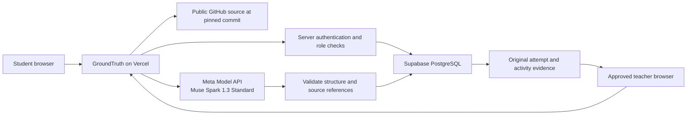

# Architecture, boundaries and attribution

**The Vercel/Supabase backend and actual Meta inference are live.** Thirty-two public API checks and eight direct real-Meta adapter tasks passed at this checkpoint. Browser capture of the generated journey is in progress. This document distinguishes tested functionality from educational claims. It is not a security certification.

## Target architecture

The hosted browser talks to GroundTruth's server. Model credentials and privileged database connection settings are server-only. The actual Supabase schema, RLS/revocation configuration, runtime database role and deployed environment must be checked before public release. Do not infer row-level protection merely from using Supabase.

## What the model owns

Generated repository summaries, selected workflow descriptions, concept suggestions, MCQs, short coding prompts, hints and supported change proposals. All are suggestions, even when schema-valid. The server checks the output shape and validates source references against the selected snapshot.

## What the application owns

Authentication, persisted roles, owner isolation, explicit teacher shares, class enrollment, source limits, model budgets, phase transitions, independent-mode restrictions, immutable submissions and persistence. A model response cannot grant access or award a grade.

## Source and change boundaries

- Imports cover public repositories and supported selected files, tied to a commit. They are not whole-repository audits or execution traces.
- README/repository text and learner text are untrusted inputs, not instructions to alter server permissions or reveal secrets.
- Imported source and submitted snippets are not executed. A short coding response is retained for review, not automatically tested or applied.
- The local prototype has a separate managed working-copy service with diff approval and stale-hash protection. Its loopback service and laptop paths must not be exposed to Vercel. Hosted Changes uses controlled cloud drafts; manual editing, review confirmation and idempotent apply have passed public checks. The draft does not execute source or push to GitHub. A direct real-Meta change proposal passed schema/source validation. The public proposal-to-apply browser route still needs its own final check.
- Reference-repository learning does not imply ownership or permission to push changes.

## Learning and evidence boundaries

Independent mode stops new study assistance within GroundTruth until submission or voluntary exit. It cannot control external tools. A submitted first answer is retained before feedback. Model answer keys can be wrong. The concept index separates unreviewed attempts from human-reviewed evidence; it is provisional, not a validated mastery score, authorship detector or automatic grade.

Teachers need an approved role and explicit project sharing to inspect learner records. Joining a class does not share all projects. Developer access is provisioned by the operator and cannot be selected during public signup.

## Cloud data handling

Selected public source, the learner's goal and contextual learning inputs may be sent to Meta for generation. Account and learning records are stored in Supabase; the application runs on Vercel. This differs from the prior laptop-only setup. Use synthetic examples in the public demo. Do not publish database contents, account secrets, raw operational traces, local working-copy backups or private learner records.

Meta Standard mode is the intended production choice. The provider says content is not used for training in this mode. This does not establish zero retention, anonymous processing, institutional compliance or permission to upload private material. [Official pricing modes](https://dev.meta.ai/docs/pricing-rate-limits)

Saved-path expiry in the current product is a visibility rule. Do not claim scheduled physical deletion unless a verified cleanup job implements it. Check the deployed retention policy before enrolling real learners.

## Original-work and assistance disclosure

GroundTruth's educational idea predates this submission. Earlier ideation was developed by **Attili Kireeti, Delfine Yew, V Narthananilaa and Dr. Wesley Tan**. This list credits the earlier proposal; it does not establish the hackathon team, consent to this entry or ownership of every component. The entrant must confirm the actual team and right to submit before accepting the competition's representations.

The hackathon implementation must be described using the commit record: repository-based workflow selection, local-to-cloud inference integration, role-based application behavior, beginner guidance, practice, independent attempts, controlled changes, class/teacher review, and responsive UI. Do not describe all earlier work as newly built during the competition.

Codex assisted coding, debugging, tests and documentation. The local workflow was developed using Qwen3.5 9B via llama.cpp before the Meta migration. Qwen and llama.cpp are not Meta model usage. Only verified Meta calls count as the submitted model contribution.

Third-party software includes React, Next.js, Drizzle, UI/icon packages and their transitive dependencies. Review the final lockfile and applicable licenses; retain required notices. The target hosting/backend services are Vercel and Supabase. The small public study-task repository is a demo input, not a real learner's measured achievement.

No benchmark in this packet establishes model superiority. No user study in this packet establishes educational effectiveness. Historical survey and proposal numbers are excluded from the pitch because the underlying evidence has not been checked for this release.

## Teacher assessment purpose and current scope

A polished AI-assisted take-home artifact can leave independent ability uncertain, while responsible AI learning should have room to demonstrate understanding. Original committed answers, observed app activity, explicit shares and provisional concept evidence can give a teacher a clearer starting point for a discussion or fresh unaided follow-up. Those choices and any teaching adjustment remain human decisions. Teacher-side AI quiz authoring, assignment distribution and cohort analytics are not built. No measured improvement in grades, fairness, learning or marking time is claimed.
