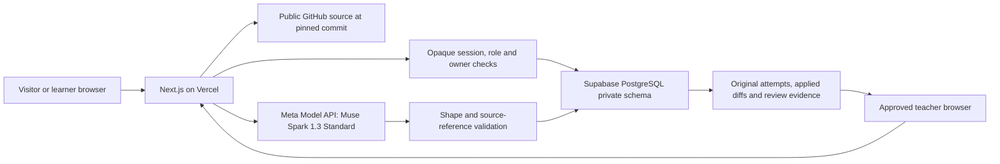

# Architecture, boundaries and attribution

**Revised release: `1e1bcfaa848150f90caf890e8d32471336f5e084` / `dpl_23T8RW7JX4r21MZ5zoLuTUZo86nE` (READY).** This identifies the verified application runtime at [the canonical deployment](https://groundtruth-meta.vercel.app/login). A following documentation/evidence commit does not change it. Exact migration, checks and media provenance belong in [release-manifest.json](release-manifest.json). It is not a security or educational-effectiveness certification.

## Architecture

The browser talks to the application server. Privileged database credentials and model keys stay on that server. The database uses a restricted application role and RLS/revocations, but end-user isolation depends primarily on server authorization and owner predicates. The release operator verified RLS on 33/33 private tables and zero security-advisor findings. These observations do not turn the shared server role’s policies into per-user database isolation or certify complete security.

## Isolated judge entry

`POST /api/demo/start` accepts no client seed/project ID. Operator configuration selects one validated public pinned seed, with a readiness record identifying genuine Meta-generated overview/concepts. It must also attest public-repository status, MIT licensing and the license commit before the sample is exposed. The server creates a unique reserved synthetic learner account, private project/map and opaque HttpOnly session. No real user's project, teacher assignment, exercise, answer or review is copied.

The session/project expires after two hours by default. Demo creation has verified-ingress-identity, global-start and active-session budgets. Temporary accounts do not consume the real signup cap. Expired demo accounts and related records are cleaned on subsequent starts; this is opportunistic cleanup, not a scheduled deletion service. A shared username/password is not used for judge sessions.

`/demo/teacher` and its API require the current visitor's authenticated temporary account. The read-only projection selects only that owner's sample. It accepts no project selector, exposes no other visitor and grants no Teacher role. Private rubric/key fields and model feedback are excluded, including after commitment in this own-demo preview. Public captured changed/original source, diff, hashes and phase/parent metadata are retained, so a 100-limit task does not fall back to the original 80-limit source. This preview is distinct from the real teacher-review permission boundary.

## Source and change boundaries

Public imports are tied to a commit and bounded selected files. Relevant-line selection improves context within a finite budget; the reading flow remains a suggested explanation of that selection, not a verified complete call graph or audit.

A private draft stores original/current source and reviewed proposals. Explicit application checks hashes and stale state. Change-linked practice reconstructs before/after source and diff from a stored owned applied proposal; it does not trust client-supplied replacement source as provenance. Linked initial/practice/fresh-variation attempts retain original responses.

The hosted app does not execute arbitrary imported code or submitted snippets, and does not push to GitHub. The [trusted sample-fixture check](evaluation/trusted-title-boundary-proof.md) passed 120 named boundary/regression cases across exact hash-checked helper variants. The actual browser-downloaded 100-limit file matched the trusted hash and was compared as data, never executed. Four separate guard tests verify the harness refusal boundary. This is not a general code runner or an external learner outcome. Reference learning does not imply ownership of that repository.

Repository text, comments, goals and learner inputs are untrusted context, not instructions to alter permissions or reveal secrets. The model cannot grant a role, override independent mode, manufacture an execution result or award a grade.

## Learning and teacher evidence

Starting an independent attempt pauses new in-app study assistance until submission or voluntary exit. The first submitted answer is preserved before follow-up. External tools remain outside the application's control. MCQ keys and review guidance are suggestions that can be wrong.

An approved teacher receives only explicitly shared projects, with privacy-scoped learner display name and relevant class labels. Enrollment alone does not share records. The queue separates committed answers awaiting review from reviewed work. Source, question, original answer, relevant in-app activity and saved human notes support a task-specific judgement. Teacher guidance/key data is restricted to authorized post-commit evidence.

Displayed concept evidence uses observed/reviewed states rather than a mastery percentage. None proves authorship, detects outside AI, establishes assessment validity or demonstrates learning gains. Teacher-side AI quiz authoring, assignment distribution and cohort analytics are future work. Developer registration remains closed and teacher signup requires approval.

## Data and observability

Selected public source, goals and contextual inputs may be processed by Meta. Accounts and learning records are persisted in Supabase; Vercel serves the application. The direct provider uses Muse Spark 1.3 Standard. Meta states Standard-mode content is not used for model training; this is not a zero-retention or institutional-compliance claim. [Official model documentation](https://dev.meta.ai/docs/models).

Sanitized receipts contain bounded task/provider/model/status/timing and available numeric usage fields. They omit prompts, learner answers, credentials and raw provider errors. A prepared sample, prerecorded video and fresh provider request are distinct evidence categories.

Normal saved paths have configured availability/retention rules; demo expiry is shorter. Visibility expiry must not be presented as scheduled physical deletion. Use synthetic public captures and never publish database dumps, operational credentials or private learner material.

## License, original work and assistance

The participant confirmed a solo hackathon implementation entry as **Kireeti Kumar** and authorized the [MIT license](../LICENSE). [NOTICE](../NOTICE) credits earlier GroundTruth ideation to **Attili Kireeti, Delfine Yew, V Narthananilaa and Dr. Wesley Tan**, separately from the hackathon roster. Attribution does not make earlier contributors entrants or imply all prior work was created during the event.

The submitted implementation builds on the earlier concept and local prototype. The commit record should identify actual hackathon work: hosted Meta integration, repository learning paths, isolated judge entry, source/diff-linked practice, teacher evidence/sharing, application authorization, persistence and responsive interface.

Codex assisted implementation, debugging, tests and documentation. Earlier local inference used Qwen through llama.cpp; those experiments are not Meta usage. React, Next.js, Drizzle, UI/icon libraries and transitive components retain their licenses. NOTICE preserves existing vendored/build-plugin notices; the MIT grant does not relicense third-party components. The public study-task repository is a synthetic input, not a learner's measured achievement. Pinned upstream MIT notices for evaluated repositories are retained in [the evaluation license folder](evaluation/licenses/README.md); original fixture bytes are unchanged.

No external user study has been conducted: **n = 0**. Automated tests, operator/source review, controlled sample checks and TinyFish browser QA are separate from participant evidence. External research motivates the problem; it does not validate GroundTruth's outcomes. All saved class/teacher review records used for this release are synthetic operator QA. [Final production checks](evaluation/production-acceptance.json) preserved previous answers and observed private-guidance/source boundaries. TinyFish’s teacher-preview redirect report was not reproduced in normal authenticated browser/API checks; the [discrepancy remains recorded](evaluation/tooling-qa.json).
